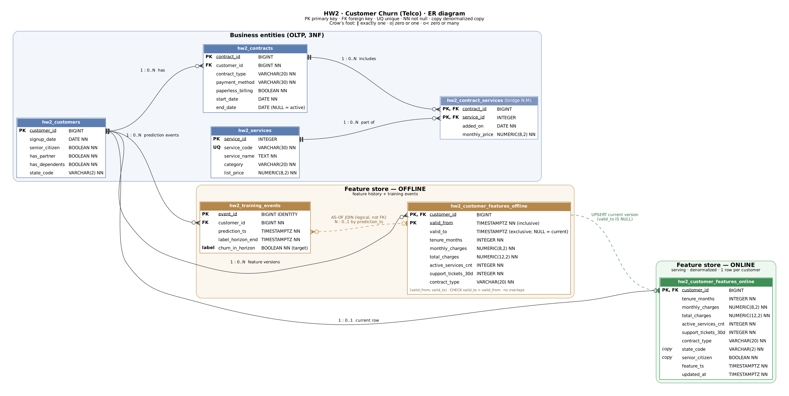

# goit-rdb-hw-02

Homework 2 for the Relational Databases course (GoIT Neoversity): designing a data schema for an ML system with a feature store and point-in-time correct training data.

**Scenario:** Customer Churn Prediction, using IBM Telco Customer Churn as the domain reference.
**Stack:** PostgreSQL 16 (via `pgserver`) in Google Colab, SQL cells via `jupysql`.

## Repository contents

| File | Description |
|---|---|
| `hw2_customer_churn.ipynb` | Main notebook with all five tasks, executed end-to-end |
| `er_diagram.png` | ER diagram |
| `er_diagram.dbml` | The same ER diagram as text DSL (can be opened at [dbdiagram.io](https://dbdiagram.io/d)) |

## ER diagram

The schema has three layers:

- **Business entities (3NF):** `hw2_customers`, `hw2_contracts`, `hw2_services` and the bridge table `hw2_contract_services` for the natural many-to-many relationship between contracts and services.
- **Offline feature store:** `hw2_customer_features_offline` stores the feature history on half-open intervals `[valid_from, valid_to)`; `hw2_training_events` stores prediction points (`prediction_ts`) and the target `churn_in_horizon`.
- **Online feature store:** `hw2_customer_features_online` keeps one denormalized row of current features per customer for low-latency lookup.

## Where to find each task in the notebook

| Task | Section | What is there |
|---|---|---|
| 1. ER diagram | 1 | Diagram, entities, cardinalities and optionality, N:M justification |
| 2. DDL | 2 | `CREATE TABLE` for 7 tables with PK, FK, NOT NULL, domain and temporal `CHECK`, indexes, overlap trigger |
| 3. Normalization | 3 | 3NF tables, functional dependencies, denormalized online table and its refresh |
| 4. Point-in-time correctness | 4 | 12 historical rows for 4 customers, 3 AS-OF queries, AS-OF training join, naive join comparison, overlap and gap checks, online refresh |
| 5. Reflection | 5 | Hardest parts, trade-offs, scaling the online layer, schema evolution risks |

Section 6 runs assertions over the main checklist items and prints `All checks passed`.

## How to run

1. Open `hw2_customer_churn.ipynb` in Google Colab.
2. Select **Runtime → Restart session and run all**.

The first cell installs everything that is needed, so no extra setup is required. It works on the current default Colab runtime (Python 3.13) as well as on Python 3.12.
